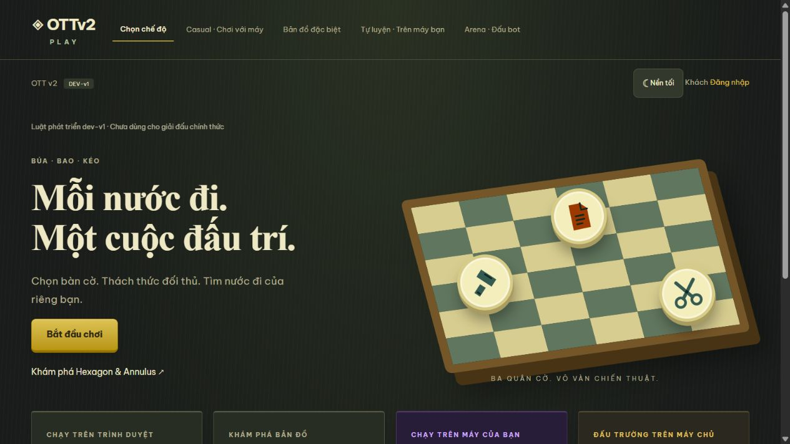
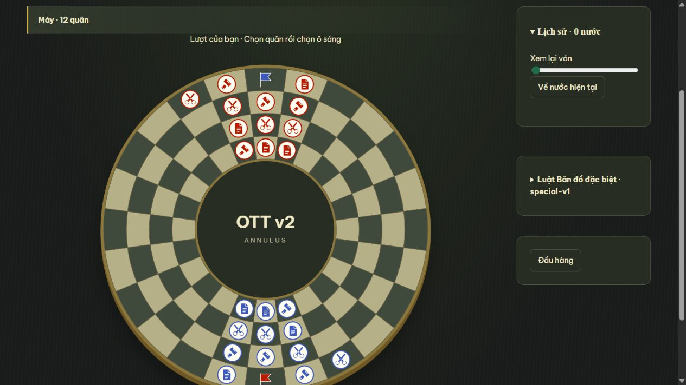
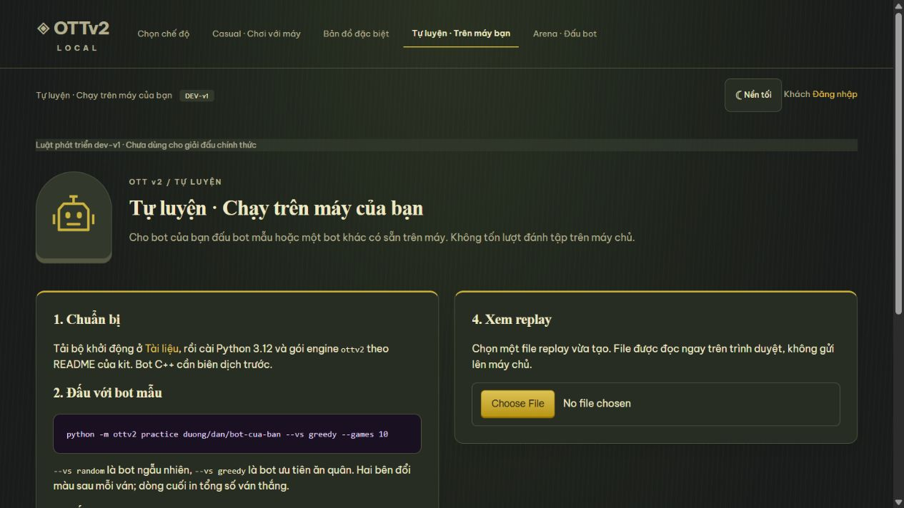

<div align="center">

# OTTv2 Arena

**Đấu trường lập trình Búa – Bao – Kéo trên bàn cờ 9×9**

🌐 **Truy cập:** [103-82-20-176.sslip.io](https://103-82-20-176.sslip.io) · Ban tổ chức: [/admin](https://103-82-20-176.sslip.io/admin/)

Chơi trực tiếp với bạn trên Casual, Hexagon và Annulus: [hướng dẫn phòng hai người](ROOM_QUICKSTART.md).

Viết bot, nộp lên máy chủ, thi đấu tự động trong sandbox và xem lại từng nước đi.

[](engine/README.md)
[](web/README.md)
[](backend/README.md)
[](infra/README.md)
[](contracts/README.md)
[](contracts/rules.md)

[Trò chơi](#trò-chơi-ottv2) · [Luật chơi](#luật-chơi) · [Chế độ chơi](#chế-độ-chơi) · [Viết bot](#viết-bot-đầu-tiên) · [Bắt đầu nhanh](#bắt-đầu-nhanh) · [Tài liệu](#tài-liệu)

</div>

<p align="center">
  
</p>

## Trò chơi OTTv2

OTTv2 là trò chơi chiến thuật hai người trên bàn cờ 9×9, lấy cảm hứng từ oẳn tù tì. Mỗi bên có 18 quân chia đều cho ba loại **Búa**, **Bao** và **Kéo**. Quân di chuyển từng ô một và chỉ ăn được loại mà nó khắc. Bên nào đưa được một quân vào ô đích ở góc đối diện, ăn hết quân đối phương hoặc khiến đối phương hết nước đi thì thắng.

Ở OTTv2 Arena, người chơi không trực tiếp cầm quân mà **viết bot** để chơi thay mình. Bot đọc thế trận từ trọng tài và trả lời nước đi. Hệ thống build bot, cho các bot đấu với nhau trong sandbox, lưu replay để xem lại trên web và tự tính bảng xếp hạng cho **giải 20 đội** gồm vòng bảng và loại trực tiếp. Ngoài ra có thể chơi trực tiếp với máy ngay trên trình duyệt để làm quen luật.


## Luật chơi

Tóm tắt theo profile phát triển **dev-v1**. Đây là luật dùng để phát triển, đang chờ ban tổ chức xác nhận. Bản đầy đủ nằm ở [contracts/rules.md](contracts/rules.md) và [contracts/rules/dev-v1.json](contracts/rules/dev-v1.json).

- **Khắc chế:** Búa ăn Kéo, Kéo ăn Bao, Bao ăn Búa.
- **Di chuyển:** mỗi lượt đi đúng một ô theo 8 hướng. Không được đứng yên, không ra khỏi bàn, không vào ô đích của đối phương.
- **Chặn đường:** quân cùng bên, quân đối phương cùng loại và quân khắc mình đều chặn, không đi vào được.
- **Thắng ván:** đưa một quân vào ô đích (Xanh: `i9`, Đỏ: `a1`), ăn hết quân đối phương, hoặc khiến đối phương hết nước đi.
- **Trần nước đi:** tối đa 300 nước, tính cả hai bên. Khi chạm trần, lần lượt so: số quân của loại còn ít nhất (nhiều hơn thắng), tổng số quân (nhiều hơn thắng), khoảng cách từ quân gần đích nhất tới đích (ngắn hơn thắng). Nếu vẫn hòa, Đỏ thắng.
- **Đồng hồ:** 10 giây khởi động, 60 giây cho cả ván mỗi bên, ân hạn 50 ms mỗi nước. Bot quá giờ, đi sai luật hoặc bị lỗi sẽ thua ván.

## Chế độ chơi

| Chế độ | Đường dẫn | Chạy ở đâu | Dành cho |
| --- | --- | --- | --- |
| **Casual** · Chơi với máy | `/casual` | Trình duyệt | Người chơi đấu bot Dễ, Trung bình hoặc Khó để làm quen luật. Ván lưu ngay trên trình duyệt. |
| **Bản đồ đặc biệt** | `/special` | Trình duyệt | Bàn Hexagon 91 ô và Annulus 96 ô theo luật thử nghiệm `special-v1` ([chi tiết](web/README.md#bản-đồ-đặc-biệt--special-v1)). |
| **Tự luyện** | `/practice` | Máy của bạn | Cho bot của bạn đấu bot mẫu hoặc bot khác, rồi mở replay cục bộ để xem. Không tốn lượt trên máy chủ. |
| **Arena** · Đấu bot | `/arena` | Máy chủ thi đấu | Nộp bot, đánh tập, theo dõi bảng xếp hạng và tham gia giải. |
| **Quản trị** | `/admin` | Máy chủ | Ban tổ chức duyệt đội, bốc thăm, điều hành từng vòng, chạy lại trận và sửa kết quả kèm lý do. |

Casual và Bản đồ đặc biệt cần đăng nhập. Tự luyện và trang chọn chế độ mở công khai.

<table>
  <tr>
    <td width="50%"></td>
    <td width="50%"></td>
  </tr>
  <tr>
    <td align="center"><sub>Bản đồ đặc biệt Annulus</sub></td>
    <td align="center"><sub>Tự luyện trên máy của bạn</sub></td>
  </tr>
</table>

## Điểm nổi bật

- **Trọng tài tất định.** Engine viết bằng Python thuần, không phụ thuộc thư viện ngoài. Cùng một package `ottv2` chạy trên máy chủ thi đấu, trong ván thử lúc build và trên máy thí sinh. Bộ stress 10.000 ván ngẫu nhiên cho kết quả lặp lại y hệt, tỷ lệ thắng của Xanh 48,75% ([báo cáo](engine/fixtures/stress-report.json)).
- **Sandbox tách biệt.** Máy chạy web không bao giờ chạy code của thí sinh. Mỗi bot chạy trong container riêng: không có mạng, hệ thống tệp chỉ đọc, giới hạn RAM và số tiến trình, ghim CPU.
- **Replay từng nước.** Trình phát replay chạy trong trình duyệt, tự áp nước bằng bản TypeScript của luật. Bản này được kiểm chéo với engine Python trên 1.000 thế cờ, 600 tình huống kết thúc và 100 ván thật.
- **Điều hành giải trọn vẹn.** Bốc thăm có seed để tái lập, đóng băng bot theo vòng, chạy lại khi lỗi hạ tầng, khóa sửa kết quả khi vòng sau đã bắt đầu.
- **Chơi ngay trên trình duyệt.** Chế độ Casual với ba độ khó, hai bản đồ đặc biệt Hexagon và Annulus, giao diện sáng/tối và hỗ trợ điện thoại.

## Viết bot đầu tiên

Bot giao tiếp với trọng tài theo từng dòng văn bản UTF-8 và phải flush stdout sau mỗi dòng:

```text
engine → OTTV2 1
bot    → READY <tên bot>
engine → INIT side=BLUE budget_ms=60000 init_ms=10000 max_turns=300
bot    → OK
engine → STATE <fen> <bên đi> <số nước đã đi> <ms còn lại của mình> <ms còn lại của đối thủ>
engine → GO
bot    → MOVE c3d4
...
engine → END <WIN|LOSS> <lý do>
```

Không cần tự viết phần giao thức. Hai bộ khởi động đã có sẵn đọc FEN, sinh nước hợp lệ, áp và hoàn tác nước, cùng bot mẫu `random` và `greedy`:

- [Python](starter-kits/python/README.md): sửa `main.py`.
- [C++20](starter-kits/cpp/README.md): sửa `main.cpp`, dùng header `ottv2.hpp`.

Đặc tả giao thức đầy đủ ở [architecture.md, mục 4](architecture.md#4-giao-thức-bot).

## Tài liệu

### Luật chơi và bot

| Tài liệu | Nội dung |
| --- | --- |
| [contracts/rules.md](contracts/rules.md) | Luật phát triển dev-v1 và thuật toán bốc thăm |
| [contracts/rules/dev-v1.json](contracts/rules/dev-v1.json) | Luật dev-v1 dạng máy đọc được |
| [architecture.md, mục 4](architecture.md#4-giao-thức-bot) | Giao thức giữa bot và trọng tài, đồng hồ |
| [starter-kits/README.md](starter-kits/README.md) | Bộ khởi động cho thí sinh: [Python](starter-kits/python/README.md), [C++](starter-kits/cpp/README.md) |
| [engine/README.md](engine/README.md) | Trọng tài OTTv2: cài đặt, CLI tự luyện, định dạng replay |

### Tổng quan hệ thống

| Tài liệu | Nội dung |
| --- | --- |
| [architecture.md](architecture.md) | Kiến trúc đầu cuối, dữ liệu, sandbox và các quyết định thiết kế |
| [integration.md](integration.md) | Bản đồ tích hợp giữa các phần và ghi chú từng phiên bản hợp đồng |
| [project_plan.md](project_plan.md) | Mục tiêu, tiêu chí nghiệm thu, phạm vi, mốc và rủi ro |

### Hợp đồng dùng chung

| Tài liệu | Nội dung |
| --- | --- |
| [contracts/README.md](contracts/README.md) | Bộ hợp đồng: nguồn sinh, cách chạy, mock server |
| [contracts/behavior.md](contracts/behavior.md) | Phân quyền, chuyển trạng thái, lease, retry, idempotency |
| [contracts/openapi.yaml](contracts/openapi.yaml) | Đặc tả HTTP API (OpenAPI 3.1) |
| [contracts/acceptance.md](contracts/acceptance.md) | Các kiểm thử bắt buộc ở từng ranh giới |

### Từng thành phần

| Thành phần | Tài liệu |
| --- | --- |
| Engine (trọng tài) | [engine/README.md](engine/README.md) |
| Runner (build và match worker) | [runner/README.md](runner/README.md) |
| Backend | [backend/README.md](backend/README.md) |
| Web | [web/README.md](web/README.md) · [cổng thí sinh](web/p1-participant/README.md) · [cổng quản trị](web/p2-admin/README.md) · [trình phát replay](web/replay-viewer/README.md) |
| Hạ tầng và triển khai | [infra/README.md](infra/README.md) |

### Vận hành và nghiệm thu

| Tài liệu | Nội dung |
| --- | --- |
| [infra/RUNBOOK.md](infra/RUNBOOK.md) | Quy trình vận hành, nâng cấp và khôi phục |
| [infra/RESOURCE_CHECKS.md](infra/RESOURCE_CHECKS.md) | Phân bổ và kiểm tra tài nguyên CPU/RAM |
| [backend/DECISIONS.md](backend/DECISIONS.md) | Quyết định đã chọn và câu hỏi còn mở của backend |
| [backend/INTEGRATION_CHECK.md](backend/INTEGRATION_CHECK.md) | Kết quả kiểm thử liên thông backend → runner → engine |
| [web/CHECKS.md](web/CHECKS.md) | Kết quả kiểm thử web và các bước nghiệm thu còn lại |
| [AGENTS.md](AGENTS.md) | Quy tắc bắt buộc khi dùng AI để phát triển trong repository |

## Cấu trúc thư mục

```text
ottv2-arena/
├── contracts/          # Hợp đồng dùng chung: OpenAPI, JSON Schema, fixture, mock, luật dev-v1
├── engine/             # Trọng tài OTTv2 (package ottv2): luật, đồng hồ, giao thức, replay, CLI
├── runner/             # Build worker và match worker: sandbox Docker, lease, callback
├── starter-kits/       # Bộ khởi động Python và C++ cho thí sinh
├── backend/            # FastAPI: REST + WebSocket, PostgreSQL, hàng đợi, logic giải đấu
├── web/                # React: cổng thí sinh, cổng quản trị, Casual, Bản đồ đặc biệt, Tự luyện
│   └── replay-viewer/  # Package @ottv2/replay-viewer dùng chung cho hai cổng
└── infra/              # Docker Compose, Caddy, WireGuard, sao lưu, runbook
```

## Công nghệ

| Lớp | Lựa chọn |
| --- | --- |
| Engine, worker | Python 3.12, không phụ thuộc thư viện ngoài cho engine |
| Backend | FastAPI, SQLAlchemy 2, Alembic, RQ |
| Dữ liệu | PostgreSQL 16, Redis 7, MinIO (tương thích S3) |
| Giao diện | React 18, Vite, TypeScript, TanStack Query/Table, React Router |
| Hạ tầng | 2 VPS, Docker Compose, Caddy, WireGuard |
