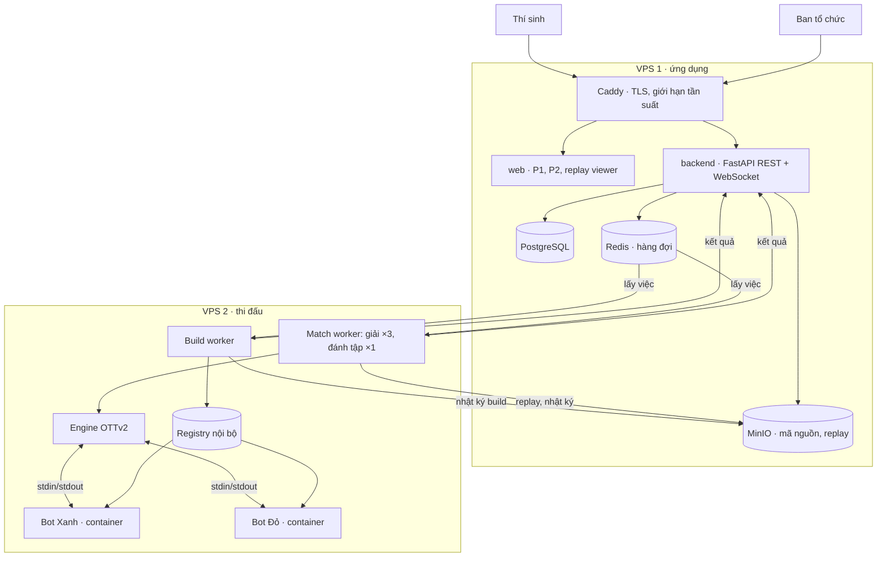
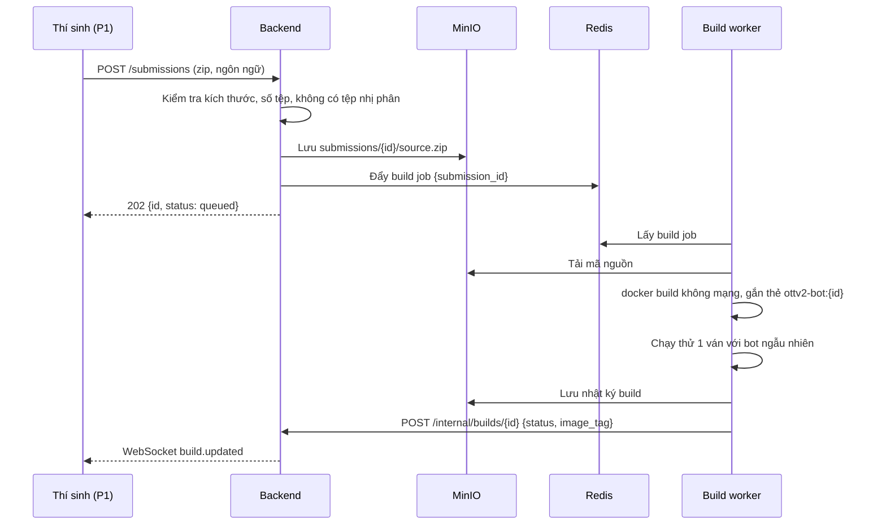
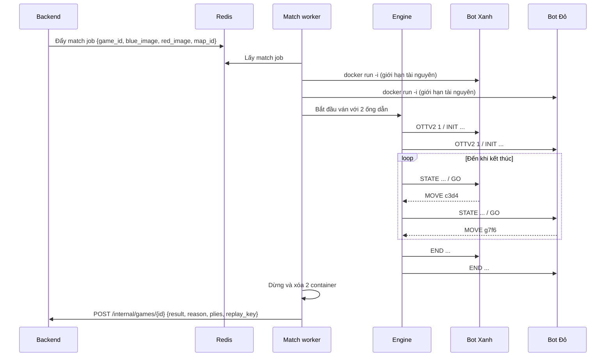
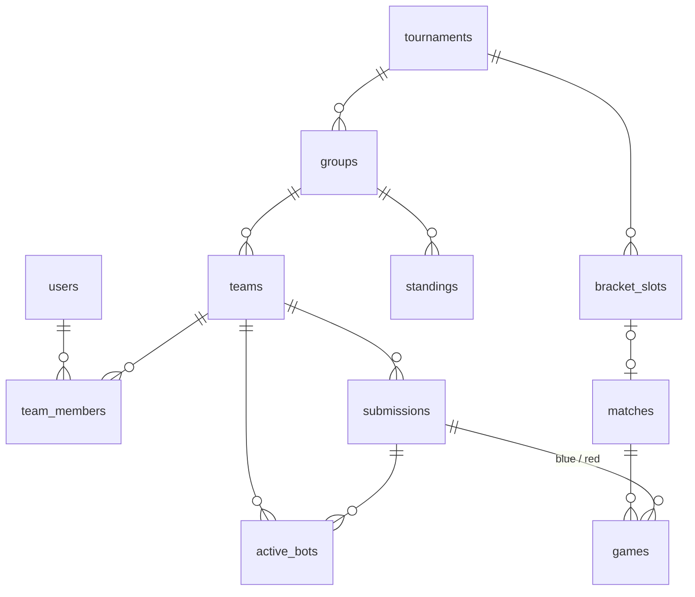

# Kiến trúc OTTv2 Arena

Chi tiết ranh giới triển khai nằm trong [integration.md](integration.md): engine API, job/callback v1, HTTP/WS, môi trường và fixture. Payload ngắn trong sơ đồ chỉ tóm tắt luồng, không thay schema đầy đủ. Đọc [AGENTS.md](AGENTS.md) trước khi giao việc cho AI; các điểm luật chưa chốt nằm ở integration mục 9.

Bộ máy đọc được đã có tại [contracts/README.md](contracts/README.md). OpenAPI/schema và behavior là nguồn chuẩn cho trường bắt buộc, role, trạng thái; lược đồ DB bên dưới là phác thảo cần bổ sung rounds/snapshots/jobs/receipts/outbox theo behavior. Profile dev-v1 chỉ để phát triển, không khẳng định đã chốt luật chính thức.

> Tài liệu này là **hợp đồng kỹ thuật** của cả nhóm. Muốn đổi giao thức, định dạng dữ liệu hay API thì sửa ở đây trước, báo cả nhóm, rồi mới sửa code.

## 1. Tổng quan

Nguyên tắc số một: **máy chạy web không bao giờ chạy code của thí sinh**. Hệ thống chia làm hai VPS. VPS 1 phục vụ người dùng và giữ dữ liệu. VPS 2 chỉ build và chạy bot, nhận việc qua hàng đợi và trả kết quả về.



Hai VPS nối với nhau qua **WireGuard**. Redis, MinIO và API nội bộ chỉ lắng nghe trên địa chỉ WireGuard, không mở ra Internet.

## 2. Thành phần

| Thành phần | Thư mục | Chạy ở | Trách nhiệm |
| --- | --- | --- | --- |
| Engine | `engine/` | VPS 2, trong match worker | Giữ trạng thái thật của ván, kiểm tra luật, đo đồng hồ, ghi replay |
| Build worker | `runner/` | VPS 2 | Biên dịch bản nộp thành image, chạy thử một ván với bot ngẫu nhiên |
| Match worker | `runner/` | VPS 2 | Chạy một trận: khởi động 2 container bot, gọi engine, đẩy kết quả. Worker giải và worker đánh tập tách riêng |
| Backend | `backend/` | VPS 1 | Xác thực, phân quyền, quản lý đội, bản nộp, trận đấu, logic giải |
| P1, P2 | `web/` | VPS 1 (tệp tĩnh) | Giao diện thí sinh và quản trị |
| Replay viewer | `web/replay-viewer/` | Trình duyệt | Phát lại ván từ tệp replay |
| Starter kits | `starter-kits/` | Máy thí sinh | Thư viện giao thức, bot mẫu, engine chạy cục bộ (tự luyện) |

## 3. Luồng đầu cuối

### 3.1 Nộp bài và build



### 3.2 Chạy một trận



### 3.3 Giải đấu

1. Quản trị viên nhập danh sách hạt giống và bấm bốc thăm. Backend sinh seed, ghi vào `audit_log`, chia 4 bảng.
2. Đến giờ đóng băng, backend chụp lại `active_bots` của mọi đội thành bản nộp chính thức của vòng.
3. Quản trị viên bấm chạy vòng. Backend tạo 10 cặp đấu mỗi bảng, mỗi cặp 2 ván đổi bên, đẩy 80 match job.
4. Mỗi kết quả trả về, backend cập nhật `standings`. Khi đủ, backend xếp hạng theo tiêu chí phụ và điền 8 đội vào `bracket_slots`.
5. Vòng loại trực tiếp chạy từng vòng. Với thể thức chạm 2 hoặc chạm 3, backend chỉ đẩy ván tiếp theo khi cặp đấu chưa phân thắng bại.

## 4. Giao thức bot

Theo dòng, UTF-8, kết dòng `\n`. Bot **phải flush stdout sau mỗi dòng**.

```
engine → OTTV2 1
bot    → READY <tên bot>
engine → INIT side=BLUE budget_ms=60000 init_ms=10000 max_turns=300
bot    → OK
engine → STATE <fen> <bên đi> <số nước đã đi> <ms còn lại của mình> <ms còn lại của đối thủ>
engine → GO
bot    → MOVE <ô nguồn><ô đích>          # ví dụ: MOVE c3d4
...
engine → END <WIN|LOSS> <lý do>
```

- Dòng stdout bắt đầu bằng `#` là ghi chú gỡ lỗi: engine lưu lại, không xử lý.
- stderr luôn được lưu, không ảnh hưởng giao thức.
- FEN: 9 hàng từ hàng 9 xuống hàng 1, ngăn bằng `/`; quân Xanh `B P K`, quân Đỏ `b p k`; số là số ô trống liên tiếp.
- Thế trận ban đầu: `9/pbkpbkpbk/kpbkpbkpb/9/9/9/BPKBPKBPK/KBPKBPKBP/9`

Lý do kết thúc: `GOAL`, `WIPEOUT`, `STALEMATE`, `TIMEOUT`, `ILLEGAL_MOVE`, `CRASH`, `MOVE_LIMIT`.

### Đồng hồ

- Ngân sách khởi động 10 giây, tính từ lúc chạy tiến trình đến khi bot gửi `OK`.
- Ngân sách ván 60 giây mỗi bên. Đồng hồ chạy từ lúc engine ghi xong `GO` đến lúc đọc xong dòng `MOVE`.
- Ân hạn 50 ms mỗi nước, không cộng dồn.
- Giới hạn cứng mỗi lượt: thời gian còn lại + 1 giây; quá thì engine đóng ống dẫn và xử thua.

## 5. Dữ liệu

### 5.1 Lược đồ quan hệ



| Bảng | Cột chính |
| --- | --- |
| `users` | `id`, `email`, `password_hash`, `role` (`member`, `captain`, `admin`), `is_active` |
| `teams` | `id`, `name`, `slug`, `status` (`pending`, `approved`, `disqualified`), `group_id`, `seed` |
| `team_members` | `team_id`, `user_id`, `role_in_team` |
| `submissions` | `id`, `team_id`, `language`, `source_key`, `sha256`, `status` (`queued`, `building`, `ready`, `failed`), `build_log_key`, `image_tag`, `submitted_at` |
| `active_bots` | `team_id`, `scope` (`scrimmage`, `tournament`), `submission_id` |
| `tournaments` | `id`, `name`, `status`, `engine_version`, `draw_seed` |
| `groups` | `id`, `tournament_id`, `label` |
| `matches` | `id`, `tournament_id` (null nếu đánh tập), `stage`, `team_a`, `team_b`, `best_of`, `status`, `winner_team_id` |
| `games` | `id`, `match_id`, `game_index`, `blue_submission_id`, `red_submission_id`, `map_id`, `engine_version`, `result`, `reason`, `total_plies`, `replay_key`, `log_key`, `duration_ms`, `attempt` |
| `standings` | `group_id`, `team_id`, `played`, `won`, `drawn`, `lost`, `points`, `game_diff`, `games_won` |
| `bracket_slots` | `tournament_id`, `round`, `slot_index`, `source_rule` (ví dụ `A1`, `W:QF1`), `team_id`, `match_id` |
| `announcements` | `id`, `title`, `body`, `published_at` |
| `audit_log` | `id`, `actor_user_id`, `action`, `target_type`, `target_id`, `payload_json`, `created_at` |
| `code_similarity` | `submission_a`, `submission_b`, `score`, `checked_at` |

Ràng buộc quan trọng:

- `submissions` không bao giờ bị sửa sau khi build xong. Đổi bot nghĩa là nộp bản mới.
- `games` có ràng buộc duy nhất `(match_id, game_index, attempt)`. Chạy lại tạo bản ghi mới với `attempt + 1`, không ghi đè.
- Chỉ mục: `submissions(team_id, submitted_at desc)`, `games(match_id, game_index)`, `matches(stage, status)`.

### 5.2 Định dạng replay

Tệp `replays/{game_id}.json.gz`:

```json
{
  "format": 1,
  "engine_version": "1.0.0",
  "ruleset_id": "dev-v1",
  "map_id": "standard",
  "initial_fen": "9/pbkpbkpbk/kpbkpbkpb/9/9/9/BPKBPKBPK/KBPKBPKBP/9",
  "players": {
    "BLUE": {"team": "doi-a", "submission_id": "…", "bot_name": "AlphaOTT"},
    "RED":  {"team": "doi-b", "submission_id": "…", "bot_name": "Greedy"}
  },
  "moves": [
    {"ply": 1, "side": "BLUE", "move": "c3d4", "think_ms": 212, "clock_ms": 59788, "capture": null, "debug": ["# eval=+3"]},
    {"ply": 2, "side": "RED",  "move": "g7f6", "think_ms": 180, "clock_ms": 59820, "capture": null, "debug": []}
  ],
  "result": {"winner": "BLUE", "reason": "GOAL", "plies": 87}
}
```

Ví dụ trên là trích đoạn minh họa, không phải fixture ván hoàn chỉnh: moves bị rút gọn. Replay thật có result.plies bằng moves.length. Replay viewer dựng lại thế trận bằng cách áp moves lên initial_fen; fixture do engine xuất và kiểm tra theo integration mục 6.

### 5.3 Lưu trữ tệp (MinIO)

```
submissions/{submission_id}/source.zip
builds/{submission_id}/build.log
replays/{game_id}.json.gz
logs/{game_id}/blue.stderr.log
logs/{game_id}/red.stderr.log
```

### 5.4 Hàng đợi (Redis + RQ)

| Hàng đợi | Nội dung việc | Người xử lý |
| --- | --- | --- |
| `build` | `{submission_id, language, source_key}` | Build worker |
| `match:tournament` | `{game_id, blue_image, red_image, map_id, engine_version}` | Chỉ worker giải (dành riêng) |
| `match:scrimmage` | như trên | Chỉ worker đánh tập; số worker là trần số ván chạy cùng lúc |

Việc thất bại vì hạ tầng (`INFRA_ERROR`) được backend tạo attempt mới và đẩy lại tối đa 3 lần sau lần đầu rồi báo quản trị viên. Worker không tự tạo attempt. Gửi lại callback do mất kết nối giữ nguyên job_id/payload, không chạy lại bot. Quy tắc dedup và callback cũ nằm ở integration mục 4.

## 6. Sandbox

| Thiết lập Docker | Giá trị |
| --- | --- |
| `--network` | `none` |
| `--memory`, `--memory-swap` | `512m`, `512m` |
| `--cpus`, `--cpuset-cpus` | `1`, lõi cố định theo worker |
| `--pids-limit` | `16` |
| `--read-only` + `--tmpfs /tmp` | bật, `/tmp` tối đa 64 MB |
| `--cap-drop` | `ALL` |
| `--security-opt` | `no-new-privileges`, seccomp mặc định |
| `--user` | `10001:10001` |
| `--ulimit fsize` | 16 MB |

Build chạy với `--network none`. Thư viện ngoài chỉ dùng được nếu có sẵn trong image nền.

Match worker giữ quyền truy cập Docker socket trên VPS 2. Đây là điểm nhạy cảm nhất của hệ thống, nên VPS 2 không chứa bất kỳ dữ liệu nào ngoài image bot và không có thông tin đăng nhập vào cơ sở dữ liệu.

## 7. API

Tiền tố `/api/v1`. Xác thực bằng JWT 15 phút + refresh token trong cookie `httpOnly`.

| Nhóm | Endpoint | Quyền |
| --- | --- | --- |
| Xác thực | `POST /auth/register`, `POST /auth/login`, `POST /auth/refresh`, `POST /auth/logout` | công khai |
| Đội | `GET /teams/me`, `PATCH /teams/me` | thành viên |
| Nộp bài | `POST /submissions`, `GET /submissions`, `GET /submissions/{id}/build-log` | thành viên |
| Bot đang dùng | `PUT /teams/me/active-bot` | đội trưởng |
| Đánh tập | `POST /scrimmages`, `GET /scrimmages` | thành viên |
| Trận, ván | `GET /matches`, `GET /matches/{id}`, `GET /games/{id}/replay` | đã đăng nhập |
| Bảng, nhánh | `GET /standings`, `GET /bracket` | công khai |
| Thông báo | `GET /announcements` | công khai |
| Quản trị | `/admin/teams`, `/admin/submissions/{id}/source`, `/admin/tournaments/{id}/draw`, `/admin/rounds/{id}/run`, `/admin/games/{id}/rerun`, `/admin/matches/{id}/override`, `/admin/similarity`, `/admin/audit-log`, `/admin/queue` | admin |
| Nội bộ | `POST /internal/builds/{id}`, `POST /internal/games/{id}` | token worker, chỉ qua WireGuard |

WebSocket `/ws`: sau khi kết nối, máy khách đăng ký kênh `team:{id}` (thành viên đội) hoặc `public`. Sự kiện: `build.updated`, `game.finished`, `match.finished`, `standings.updated`, `announcement.published`.

## 8. Triển khai

| Máy | Cấu hình | Dịch vụ |
| --- | --- | --- |
| VPS 1 | 2 vCPU, 4 GB RAM, 80 GB SSD | Caddy, web, backend, PostgreSQL, Redis, MinIO |
| VPS 2 | 8 vCPU, 8 GB RAM, 100 GB SSD | build worker, 3 match worker giải, 1 match worker đánh tập, registry |

- Sao lưu PostgreSQL mỗi giờ trong thời gian giải, đồng bộ MinIO ra kho ngoài mỗi ngày.
- Cảnh báo khi: hàng đợi dài quá 50 việc, tỷ lệ `INFRA_ERROR` quá 2%, đĩa còn dưới 20%, worker không báo nhịp tim quá 5 phút.

## 9. Quyết định thiết kế

| ID | Quyết định | Lý do | Hệ quả |
| --- | --- | --- | --- |
| ADR-001 | Bot là tiến trình độc lập, nói chuyện qua stdin/stdout | Hỗ trợ mọi ngôn ngữ mà không phải viết binding riêng | Phải tự lo flush, độ trễ ống dẫn; engine không tin bot |
| ADR-002 | Thông tin mở hoàn toàn | Engine đơn giản, đề thi thuần thuật toán tìm kiếm | Không có yếu tố đánh lừa; bot không cần tự theo dõi lịch sử |
| ADR-003 | Đồng hồ cờ vua, đo thời gian tường | Thí sinh tự phân bổ thời gian; dễ hiểu | Phụ thuộc tải máy, nên phải ghim CPU, một trận một worker, ân hạn 50 ms |
| ADR-004 | Build tách khỏi trận đấu | Báo lỗi sớm cho thí sinh; đồng hồ không tính thời gian biên dịch | Cần registry nội bộ và một worker riêng |
| ADR-005 | Hai VPS, máy web không chạy code thí sinh | Bot thoát sandbox cũng không chạm dữ liệu | Thêm WireGuard và chi phí một máy |
| ADR-006 | Engine viết bằng Python, dùng chung với starter kit Python | Một nguồn sự thật cho luật; thí sinh chạy đúng engine của giải trên máy mình | Engine chậm hơn C++, nhưng chỉ kiểm tra 1 nước mỗi lượt nên không đáng kể |
| ADR-007 | Logic luật tất định, bản nộp bất biến | Cùng thế trận và chuỗi nước cho cùng kết quả luật; replay phục vụ đối chiếu | Test dùng seed và clock giả; chạy lại tiến trình với đồng hồ tường có thể khác thời gian/kết quả; không sửa bản nộp |
| ADR-008 | Replay chỉ lưu dãy nước đi, không lưu thế trận từng nước | Tệp nhỏ, dưới 20 KB mỗi ván | Replay viewer phải có logic áp nước đi (bản TypeScript của luật di chuyển) |
| ADR-009 | Redis + RQ, không dùng Celery hay Kafka | Đủ cho 20 đội, cả nhóm đã quen Python | Không có lập lịch phức tạp; ưu tiên làm bằng hai hàng đợi tách biệt |
| ADR-010 | Không có hòa ở cả ván và cặp đấu loại trực tiếp | Theo luật ban tổ chức; số ván lẻ ở vòng loại | Vòng bảng vẫn có hòa 1–1 ở cấp cặp đấu, tính 1 điểm |
| ADR-011 | Chạy lại tạo bản ghi `games` mới với `attempt + 1` | Giữ dấu vết, không mất kết quả cũ | Mọi truy vấn lấy kết quả phải chọn `attempt` lớn nhất |

Từ contract 1.1.0, đăng ký công khai tạo captain và đội pending; pending được đánh tập, approved mới được bốc thăm giải. Chi tiết tại contracts/behavior.md.

## Chế độ chơi và phân bổ tài nguyên từ contract 1.3.0

P1 `/` chọn chế độ; Arena dashboard ở `/arena`, các route Arena khác và P2 giữ nguyên.

- **Casual** (`/casual`, cần đăng nhập): bàn cờ và bot mẫu random/greedy chạy trong trình duyệt bằng bản TypeScript của luật dev-v1 trong `@ottv2/replay-viewer`, kiểm chéo với engine bằng fixture. Ván lưu trong localStorage theo tài khoản; server không nhận nước đi, không chạy bot. Contract 1.2.0 từng có API `/casual/games` và bảng `casual_games`; 1.3.0 gỡ API, giữ bảng không dùng để không mất dữ liệu cũ.
- **Tự luyện** (`/practice`, công khai): bot của thí sinh đấu bot mẫu hoặc một bot khác trên máy thí sinh bằng `python -m ottv2 practice`, dùng chính engine Python. P1 chỉ hướng dẫn và mở file replay cục bộ để xem; không upload.
- **Đánh tập giữa các đội**: vẫn chạy trên VPS 2 nhưng trên worker riêng của `match:scrimmage`, số worker là trần số ván cùng lúc. Backend giới hạn số trận chưa xong của mỗi đội và tạm dừng nhận trận mới khi giải có việc, khi tồn đọng đánh tập vượt ngưỡng hoặc khi admin tạm dừng hàng đợi.
- **Giải chính thức**: worker và lõi CPU riêng chỉ nghe `match:tournament`. Trận đánh tập đã nhận trước lúc tạm dừng chạy hết trên worker đánh tập, không bị hủy và không chiếm worker giải.

Chi tiết lỗi, ngưỡng và trường API ở mục Phân bổ tài nguyên của [contracts/behavior.md](contracts/behavior.md).

### Bổ sung cách ly tài nguyên runner — 2026-10-22

B phụ trách áp cấu hình: bot giải 0–5, mọi worker/registry/compiler/smoke/đấu tập trên CPU phụ trợ 6–7 ở VPS2; local tách worker giải/đấu tập với CPU giải 0–1, phụ trợ 2–3. `RUNNER_CPUSET_BUILD` dùng chung compiler và smoke, tránh ghim cứng CPU 0. Xem infra/README.md và check_resources.py về ngân sách tổng, giới hạn Docker và preflight. Không đổi phân công, HTTP 1.3.0, job/callback v1, replay hay luật dev-v1. Backend và frontend không cần sửa; worker image và Compose cần nâng cùng nhau sau khi drain hàng đợi. CPU pinning không bảo đảm hết ảnh hưởng từ OS, I/O hoặc SMT; không tuyên bố độ lệch thời gian đạt chuẩn nếu chưa benchmark host thực tế.
