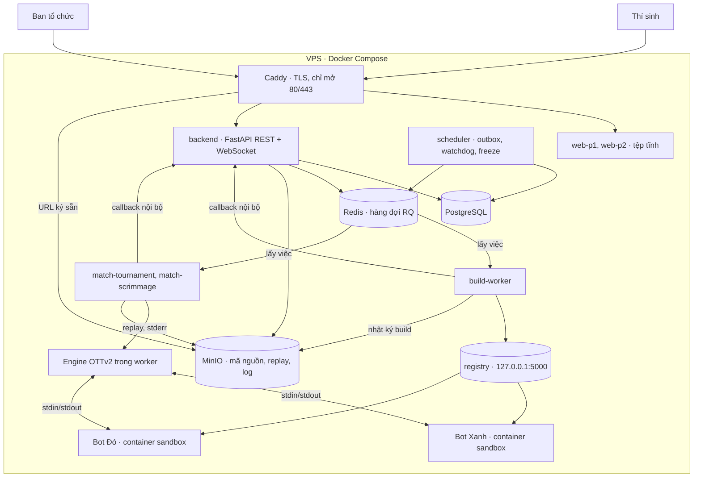
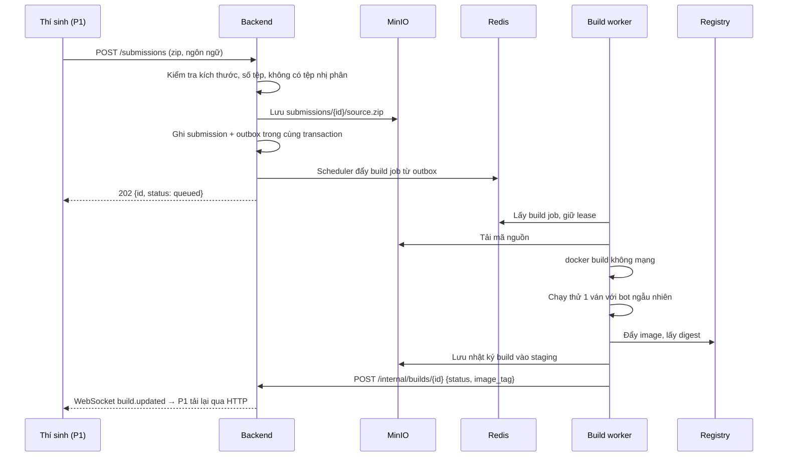
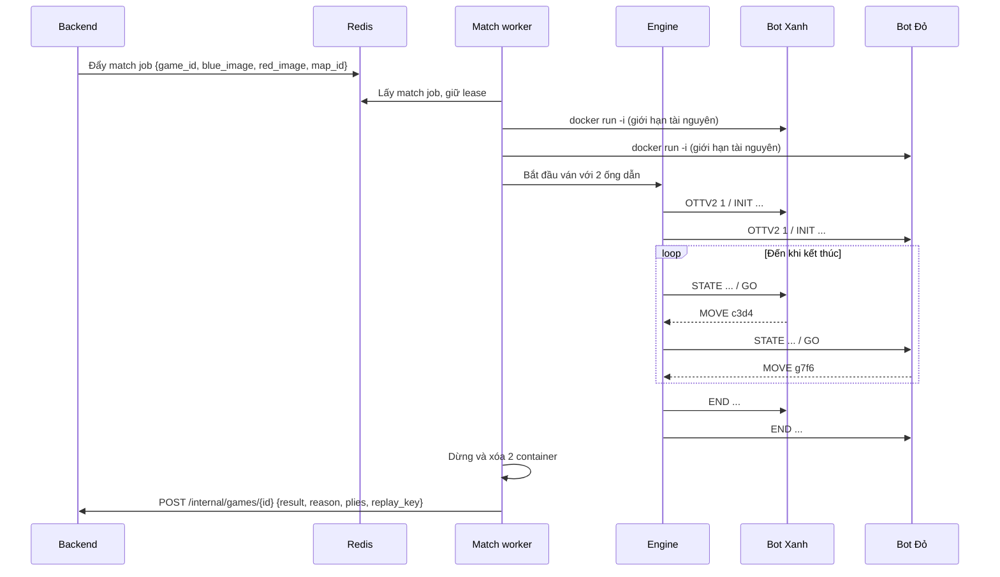

# Kiến trúc OTTv2 Arena

Tài liệu này mô tả cách các phần ghép với nhau và cách triển khai. Tên trường, kiểu dữ liệu, quyền và chuyển trạng thái chuẩn nằm trong [contracts/](contracts/README.md) (OpenAPI, JSON Schema, [behavior.md](contracts/behavior.md)); khi lệch nhau, theo contracts. Sơ đồ và ví dụ ở đây là bản rút gọn, không dùng làm golden test. Ranh giới giữa các phần: [integration.md](integration.md). Luật đang dùng là profile phát triển `dev-v1`, chưa được ban tổ chức xác nhận.

> Backend trích nguyên văn mục 4 (từ heading `## 4.` tới heading `## 5.`) để hiển thị ở trang Tài liệu của P1 qua `GET /api/v1/docs`. Khi sửa tài liệu, giữ dạng heading `## <số>. <tên>`.

## 1. Tổng quan

Toàn bộ hệ thống chạy trên **một VPS** bằng Docker Compose. Phạm vi là bài tập lớn: các nhóm dùng thử tính năng và demo trên lớp, không phải giải đấu có thưởng, nên một máy là đủ.

Nguyên tắc số một vẫn giữ: **web và backend không bao giờ chạy code của thí sinh**. Code thí sinh chỉ chạy trong container sandbox do worker tạo qua Docker daemon. Worker không có `DATABASE_URL` hay `JWT_SECRET`; chúng chỉ gọi API nội bộ của backend bằng token riêng.



Mạng: chỉ Caddy publish cổng ra Internet (80/443). Backend, Redis và MinIO chỉ bind `127.0.0.1` hoặc nằm trong mạng Docker; worker gọi chúng bằng tên service (`backend:8000`, `redis:6379`, `minio:9000`). Caddy trả 404 cho `/internal` và `/api/v1/internal`. Container bot chạy với `--network none`, không thấy mạng Docker. Không cần WireGuard.

Compose vẫn chia hai nhóm theo tên file cũ: `docker-compose.vps1.yml` (ứng dụng, dữ liệu) và `docker-compose.vps2.yml` (thi đấu). Một VPS gộp cả hai cùng override `docker-compose.single.yml`, xem [infra/README.md](infra/README.md). Khi cần giải nghiêm túc hơn, có thể chuyển nhóm thi đấu sang máy riêng nối bằng WireGuard mà không phải sửa code.

## 2. Thành phần

| Thành phần | Thư mục | Service Compose | Trách nhiệm |
| --- | --- | --- | --- |
| Engine | `engine/` | nằm trong image worker | Giữ trạng thái thật của ván, kiểm tra luật, đo đồng hồ, ghi replay |
| Build worker | `runner/` | `build-worker` | Kiểm tra ZIP, build image bot không mạng, chạy thử một ván với bot ngẫu nhiên, đẩy image vào registry |
| Match worker | `runner/` | `match-tournament-1`, `match-scrimmage-1` | Chạy một ván: khởi động 2 container bot, gọi engine, đẩy replay và kết quả. Worker giải và worker đánh tập tách riêng |
| Backend | `backend/` | `backend`, `scheduler` | Xác thực, phân quyền, đội, bản nộp, trận đấu, logic giải, phòng hai người, hồ sơ |
| P1, P2 | `web/` | `web-p1`, `web-p2` | Giao diện thí sinh (`/`) và quản trị (`/admin/`) |
| Replay viewer | `web/replay-viewer/` | chạy trong trình duyệt | Phát lại ván từ tệp replay |
| Starter kits | `starter-kits/` | máy thí sinh | Thư viện giao thức, bot mẫu, công cụ tự luyện |
| Hạ tầng | `infra/` | `caddy`, `postgres`, `redis`, `minio`, `registry` | Reverse proxy, dữ liệu, hàng đợi, kho image bot, sao lưu |

## 3. Luồng đầu cuối

### 3.1 Nộp bài và build



### 3.2 Chạy một ván



Lease nằm ở Redis `ottv2:lease:{job_id}`, TTL 90 giây, gia hạn mỗi 15 giây. Callback được ghi vào outbox trên volume của worker trước khi gửi; mất kết nối thì gửi lại đúng payload đó, không chạy lại bot. Backend xác nhận lease, chuyển artifact từ staging sang khóa chính thức, cập nhật trạng thái và bảng điểm, rồi mới phát WebSocket. Sự kiện WebSocket chỉ báo frontend tải lại, không bao giờ là nguồn tính điểm.

### 3.3 Giải đấu

1. Thí sinh tự đăng ký: tài khoản đầu tiên là đội trưởng của một đội `pending`. Đội pending được nộp bot và đánh tập; quản trị viên duyệt thành `approved` mới được bốc thăm.
2. Quản trị viên nhập hạt giống và bốc thăm. Backend sinh seed, ghi `audit_log`, chia 4 bảng bằng thuật toán `xorshift32-fisher-yates-rejection-v1`.
3. Đến giờ đóng băng, backend chụp bot thi đấu của mọi đội thành snapshot bất biến của vòng.
4. Quản trị viên bấm chạy vòng. Backend tạo 10 cặp mỗi bảng, mỗi cặp 2 ván đổi bên, đẩy 80 match job vào `match:tournament`.
5. Mỗi kết quả trả về, backend cập nhật `standings`. Khi đủ, backend xếp hạng theo tiêu chí phụ và điền 8 đội vào `bracket_slots`.
6. Vòng loại trực tiếp chạy từng vòng. Với thể thức chạm 2 hoặc chạm 3, backend chỉ đẩy ván tiếp theo khi cặp chưa phân thắng bại.

Chạy lại ván hoặc sửa kết quả bị khóa (`409 DOWNSTREAM_STARTED`) khi vòng sau đã đóng băng hoặc giải đã kết thúc. Ruleset `dev-v1` đang ở trạng thái development nên backend chặn tạo giải (`RULESET_UNCONFIRMED`) trừ khi bật `ALLOW_DEVELOPMENT_TOURNAMENTS=true`; chỉ bật để demo.

### 3.4 Chế độ không dùng worker

| Chế độ | Chạy ở | Ghi chú |
| --- | --- | --- |
| Casual (`/casual`) | Trình duyệt | Luật bằng bản TypeScript trong `@ottv2/replay-viewer`, kiểm chéo với engine bằng fixture. Ván lưu localStorage theo tài khoản; server không nhận nước đi |
| Bản đồ đặc biệt (`/special`) | Trình duyệt | Hexagon và Annulus theo luật thử nghiệm `special-v1`, lưu localStorage |
| Tự luyện (`/practice`) | Máy thí sinh | `python -m ottv2 practice` dùng chính engine Python; P1 chỉ mở file replay cục bộ |
| Phòng hai người (`/rooms`) | Backend | Server kiểm tra từng nước, lưu snapshot trong `play_rooms`, client hỏi lại mỗi 2 giây. Kết quả bất biến ghi vào `room_results` để làm thống kê hồ sơ ([rooms.md](contracts/rooms.md), [profiles.md](contracts/profiles.md)) |

Các chế độ này không tạo job, không chạm runner và không trộn vào thành tích bot Arena.

## 4. Giao thức bot

Theo dòng, UTF-8, kết dòng `\n`. Bot **phải flush stdout sau mỗi dòng**.

```
engine → OTTV2 1
bot    → READY <tên bot>
engine → INIT side=BLUE budget_ms=60000 init_ms=10000 max_turns=300
bot    → OK
engine → STATE <fen> <bên đi> <số nước đã đi> <ms còn lại của mình> <ms còn lại của đối thủ>
engine → GO
bot    → MOVE <ô nguồn><ô đích>          # ví dụ: MOVE c3d4
...
engine → END <WIN|LOSS> <lý do>
```

- Dòng stdout bắt đầu bằng `#` là ghi chú gỡ lỗi: engine lưu lại, không xử lý.
- stderr luôn được lưu, không ảnh hưởng giao thức.
- FEN: 9 hàng từ hàng 9 xuống hàng 1, ngăn bằng `/`; quân Xanh `B P K`, quân Đỏ `b p k`; số là số ô trống liên tiếp.
- Thế trận ban đầu: `9/pbkpbkpbk/kpbkpbkpb/9/9/9/BPKBPKBPK/KBPKBPKBP/9`

Lý do kết thúc: `GOAL`, `WIPEOUT`, `STALEMATE`, `TIMEOUT`, `ILLEGAL_MOVE`, `CRASH`, `MOVE_LIMIT`.

### Đồng hồ

- Ngân sách khởi động 10 giây, tính từ lúc chạy tiến trình đến khi bot gửi `OK`.
- Ngân sách ván 60 giây mỗi bên. Đồng hồ chạy từ lúc engine ghi xong `GO` đến lúc đọc xong dòng `MOVE`.
- Ân hạn 50 ms mỗi nước, không cộng dồn.
- Giới hạn cứng mỗi lượt: thời gian còn lại + 1 giây; quá thì engine đóng ống dẫn và xử thua.

## 5. Dữ liệu

### 5.1 Bảng PostgreSQL

Lược đồ chính xác nằm trong `backend/app/models.py` và `backend/migrations/` (head hiện tại `0004`). Nhóm bảng:

| Nhóm | Bảng |
| --- | --- |
| Tài khoản | `users`, `refresh_token_families`, `refresh_tokens`, `player_profiles` |
| Đội và bot | `teams`, `team_members`, `submissions`, `active_bots` |
| Giải đấu | `tournaments`, `groups`, `group_teams`, `rounds`, `round_snapshots`, `frozen_bots`, `matches`, `games`, `match_overrides`, `standings`, `tiebreak_lots`, `bracket_slots` |
| Hàng đợi, worker | `worker_jobs`, `callback_receipts`, `outbox`, `workers`, `queue_controls`, `idempotency_records` |
| Phòng hai người | `play_rooms`, `room_results` |
| Vận hành | `announcements`, `audit_log`, `code_similarity` |
| Không còn dùng | `casual_games` (giữ dữ liệu cũ từ contract 1.2.0) |

Ràng buộc quan trọng:

- `submissions` không bị sửa sau khi build xong. Đổi bot nghĩa là nộp bản mới.
- `games` duy nhất theo `(match_id, game_index, attempt)`. Chạy lại tạo bản ghi mới với `attempt + 1`, không xóa hay ghi đè; kết quả hiện hành là attempt lớn nhất (`is_current`).
- Chỉ backend tạo attempt. Lỗi hạ tầng hoặc lease hết hạn → attempt mới, tối đa 4 attempt.
- Snapshot bot của vòng đã đóng băng là bất biến.

### 5.2 Định dạng replay

Tệp `replays/{game_id}.json.gz`:

```json
{
  "format": 1,
  "engine_version": "1.0.0",
  "ruleset_id": "dev-v1",
  "map_id": "standard",
  "initial_fen": "9/pbkpbkpbk/kpbkpbkpb/9/9/9/BPKBPKBPK/KBPKBPKBP/9",
  "players": {
    "BLUE": {"team": "doi-a", "submission_id": "…", "bot_name": "AlphaOTT"},
    "RED":  {"team": "doi-b", "submission_id": "…", "bot_name": "Greedy"}
  },
  "moves": [
    {"ply": 1, "side": "BLUE", "move": "c3d4", "think_ms": 212, "clock_ms": 59788, "capture": null, "debug": ["# eval=+3"]},
    {"ply": 2, "side": "RED",  "move": "g7f6", "think_ms": 180, "clock_ms": 59820, "capture": null, "debug": []}
  ],
  "result": {"winner": "BLUE", "reason": "GOAL", "plies": 87}
}
```

Ví dụ trên bị rút gọn `moves`. Replay thật có `result.plies` bằng số phần tử `moves`. Viewer dựng lại thế trận bằng cách áp `moves` lên `initial_fen`; schema đầy đủ ở `contracts/schemas/`, replay thật do engine xuất ở `engine/fixtures/`.

### 5.3 Lưu trữ tệp (MinIO)

```
submissions/{submission_id}/source.zip
builds/{submission_id}/build.log
replays/{game_id}.json.gz
logs/{game_id}/blue.stderr.log
logs/{game_id}/red.stderr.log
```

Worker chỉ ghi vào `staging/{job_id}/{lease_token}/...`; backend chuyển sang các khóa trên khi nhận callback hợp lệ. Trình duyệt tải replay bằng URL ký sẵn qua `STORAGE_DOMAIN`.

### 5.4 Hàng đợi (Redis + RQ)

| Hàng đợi | Nội dung việc | Worker |
| --- | --- | --- |
| `build` | `{submission_id, language, source_key}` | `build-worker` |
| `match:tournament` | `{game_id, blue_image, red_image, map_id, engine_version}` | Chỉ `match-tournament-*` |
| `match:scrimmage` | như trên | Chỉ `match-scrimmage-*`; số worker là trần số ván đánh tập chạy cùng lúc |

RQ job id bằng `payload.job_id`; hàm nhận việc là `ottv2_runner.jobs.build_submission` và `ottv2_runner.jobs.run_match`. Worker không tự tạo attempt và không tự chạy lại ván.

Backend chỉ nhận trận đánh tập mới khi tải cho phép: trả `503 SCRIMMAGE_PAUSED` khi giải đang có việc, khi tồn đọng đánh tập vượt ngưỡng hoặc khi admin tạm dừng hàng đợi; trả `429 SCRIMMAGE_LIMIT` khi đội đã có quá nhiều trận chưa xong. Trận đã nhận không bị hủy và không chuyển sang worker giải. Ngưỡng: biến `SCRIMMAGE_*` trong [contracts/behavior.md](contracts/behavior.md).

## 6. Sandbox

| Thiết lập Docker | Giá trị |
| --- | --- |
| `--network` | `none` |
| `--memory`, `--memory-swap` | `512m`, `512m` |
| `--cpus`, `--cpuset-cpus` | `1`, lõi cố định theo worker |
| `--pids-limit` | `16` |
| `--read-only` + `--tmpfs /tmp` | bật, `/tmp` tối đa 64 MB |
| `--cap-drop` | `ALL` |
| `--security-opt` | `no-new-privileges`, seccomp mặc định |
| `--user` | `10001:10001` |
| `--ulimit fsize` | 16 MB |

Build cũng chạy với `--network none` bằng Dockerfile do hệ thống sinh; không chạy Dockerfile, script cài đặt hay lệnh shell của thí sinh. Thư viện ngoài chỉ dùng được nếu có sẵn trong image nền.

Worker mount `/var/run/docker.sock`, tương đương quyền root trên VPS. Vì chỉ có một VPS, máy này cũng giữ PostgreSQL và MinIO: một bot thoát được sandbox về lý thuyết chạm tới dữ liệu. Đây là rủi ro chấp nhận cho phạm vi bài tập lớn. Các lớp giảm thiểu: container bot không mạng, chỉ đọc, không capability, không chạy bằng root; image worker cố định và không chứa secret DB/JWT; chỉ chạy bot qua Dockerfile do hệ thống sinh. Nếu mở cho người ngoài nộp bài hoặc có giải thưởng, tách nhóm thi đấu sang máy riêng (ADR-005).

## 7. API

Tiền tố `/api/v1`. Xác thực bằng JWT 15 phút + refresh token trong cookie `httpOnly`. Mọi mutation (trừ `/auth/*` và endpoint worker) cần header `Idempotency-Key`.

| Nhóm | Endpoint | Quyền |
| --- | --- | --- |
| Xác thực | `POST /auth/register`, `POST /auth/login`, `POST /auth/refresh`, `POST /auth/logout`, `GET /auth/me` | công khai / đã đăng nhập |
| Đội | `GET /teams/me`, `PATCH /teams/me` | thành viên |
| Nộp bài | `POST /submissions`, `GET /submissions`, `GET /submissions/{id}/build-log` | thành viên |
| Bot đang dùng | `PUT /teams/me/active-bot` | đội trưởng |
| Đánh tập | `POST /scrimmages`, `GET /scrimmages`, `GET /scrimmages/quota` | thành viên |
| Trận, ván | `GET /matches`, `GET /matches/{id}`, `GET /games/{id}/replay` | đã đăng nhập |
| Bảng, nhánh | `GET /standings`, `GET /bracket` | công khai |
| Thông báo, tài liệu | `GET /announcements`, `GET /docs` | công khai |
| Phòng hai người | `POST /rooms`, `GET /rooms`, `POST /rooms/join`, `GET /rooms/{id}`, `POST /rooms/{id}/commands` | đã đăng nhập |
| Hồ sơ | `GET /profiles/me`, `PUT /profiles/me`, `GET /profiles/{user_id}` | đã đăng nhập / công khai |
| Quản trị | `/admin/teams`, `/admin/submissions/{id}/source`, `/admin/tournaments/{id}/draw`, `/admin/rounds/{id}/run`, `/admin/games/{id}/rerun`, `/admin/matches/{id}/override`, `/admin/similarity`, `/admin/audit-log`, `/admin/queue` | admin |
| Nội bộ | `POST /internal/builds/{id}`, `POST /internal/games/{id}`, `POST /internal/workers/heartbeat` | token worker + `X-Worker-Lease`; chỉ trong mạng Docker, Caddy trả 404 |

Danh sách đầy đủ và schema: [contracts/openapi.yaml](contracts/openapi.yaml).

WebSocket `/ws`: sau khi xác thực, máy khách đăng ký kênh `team:{id}` (thành viên đội) hoặc `public`. Sự kiện: `build.updated`, `game.finished`, `match.finished`, `standings.updated`, `announcement.published`.

## 8. Triển khai

| Mục | Giá trị |
| --- | --- |
| Máy | 1 VPS Ubuntu 24.04, 4 vCPU, 8 GB RAM, 60 GB SSD |
| Tên miền | `DOMAIN` cho web và API, `STORAGE_DOMAIN` cho URL ký sẵn của MinIO. Không mua domain thì dùng `<ip-nối-bằng-gạch>.sslip.io`; vẫn cần HTTPS vì cookie refresh mặc định `Secure` |
| Service | `caddy`, `web-p1`, `web-p2`, `backend`, `scheduler`, `postgres`, `redis`, `minio`, `registry`, `build-worker`, `match-tournament-1`, `match-scrimmage-1` |
| Image | Build ngay trên VPS từ repo; image bot nền được đẩy vào registry `127.0.0.1:5000` để có digest cố định |

Phân bổ CPU cho máy 4 vCPU:

| CPU | Dùng cho |
| --- | --- |
| 0–1 | Hai bot của ván giải (`match-tournament-1`) |
| 2–3 | Phụ trợ: compiler và ván thử của build, hai bot đánh tập, registry, tiến trình worker |
| không ghim | Caddy, web, backend, scheduler, PostgreSQL, Redis, MinIO |

Mỗi lúc chỉ chạy một ván giải và một ván đánh tập; 80 ván vòng bảng chạy tuần tự. Các dịch vụ không ghim CPU vẫn có thể chen vào CPU 0–1 nên thời gian đo có nhiễu; trước ván quan trọng, tạm dừng hàng đợi `build` và `match:scrimmage` trong P2. Máy 8 vCPU dùng lại bố trí CPU mặc định của `vps2.env.example` và bật profile `8cpu` để có thêm `match-tournament-2`, `match-tournament-3`.

RAM: phần thi đấu tối đa khoảng 4.3 GiB (3 worker × 512 MiB, 4 bot × 512 MiB, compiler 512 MiB, registry 256 MiB), phần còn lại cho dịch vụ web và dữ liệu. Không tăng giới hạn CPU/RAM của từng bot vì sẽ đổi điều kiện thi đấu. `infra/check_resources.py` kiểm tra bố trí trước khi bật worker.

Vận hành:

- Sao lưu PostgreSQL mỗi giờ trong thời gian giải (`infra/backup/postgres-backup.sh`) và chép bản sao ra ngoài VPS: mất máy là mất cả dữ liệu lẫn bản sao tại chỗ. Đồng bộ MinIO ra kho ngoài là tùy chọn (profile `backup`).
- Cảnh báo khi: hàng đợi dài quá 50 việc, tỷ lệ `INFRA_ERROR` quá 2%, đĩa còn dưới 20%, worker không báo nhịp tim quá 5 phút.

## 9. Quyết định thiết kế

| ID | Quyết định | Lý do | Hệ quả |
| --- | --- | --- | --- |
| ADR-001 | Bot là tiến trình độc lập, nói chuyện qua stdin/stdout | Hỗ trợ mọi ngôn ngữ mà không phải viết binding riêng | Phải tự lo flush, độ trễ ống dẫn; engine không tin bot |
| ADR-002 | Thông tin mở hoàn toàn | Engine đơn giản, đề thi thuần thuật toán tìm kiếm | Không có yếu tố đánh lừa; bot không cần tự theo dõi lịch sử |
| ADR-003 | Đồng hồ cờ vua, đo thời gian tường | Thí sinh tự phân bổ thời gian; dễ hiểu | Phụ thuộc tải máy, nên phải ghim CPU, một ván một worker, ân hạn 50 ms |
| ADR-004 | Build tách khỏi trận đấu | Báo lỗi sớm cho thí sinh; đồng hồ không tính thời gian biên dịch | Cần registry nội bộ và một worker riêng |
| ADR-005 | Một VPS cho cả ứng dụng và thi đấu; code thí sinh chỉ chạy trong container sandbox | Phạm vi bài tập lớn và demo, giảm chi phí và công vận hành | Bot thoát sandbox có thể chạm dữ liệu trên cùng máy; giữ hai file Compose vps1/vps2 để tách máy khi cần |
| ADR-006 | Engine viết bằng Python, dùng chung với starter kit Python | Một nguồn sự thật cho luật; thí sinh chạy đúng engine của giải trên máy mình | Engine chậm hơn C++, nhưng chỉ kiểm tra 1 nước mỗi lượt nên không đáng kể |
| ADR-007 | Logic luật tất định, bản nộp bất biến | Cùng thế trận và chuỗi nước cho cùng kết quả luật; replay phục vụ đối chiếu | Test dùng seed và clock giả; chạy lại tiến trình với đồng hồ tường có thể khác thời gian/kết quả; không sửa bản nộp |
| ADR-008 | Replay chỉ lưu dãy nước đi, không lưu thế trận từng nước | Tệp nhỏ, dưới 20 KB mỗi ván | Replay viewer phải có logic áp nước đi (bản TypeScript của luật di chuyển) |
| ADR-009 | Redis + RQ, không dùng Celery hay Kafka | Đủ cho 20 đội, dùng Python thuần | Không có lập lịch phức tạp; ưu tiên làm bằng hai hàng đợi tách biệt |
| ADR-010 | Không có hòa ở cả ván và cặp đấu loại trực tiếp | Theo luật ban tổ chức; số ván lẻ ở vòng loại | Vòng bảng vẫn có hòa 1–1 ở cấp cặp đấu, tính 1 điểm |
| ADR-011 | Chạy lại tạo bản ghi `games` mới với `attempt + 1` | Giữ dấu vết, không mất kết quả cũ | Mọi truy vấn lấy kết quả phải chọn attempt hiện hành |
| ADR-012 | Casual, bản đồ đặc biệt và tự luyện không chạy trên máy chủ | Một VPS nhỏ chỉ nên gánh build, ván Arena và phòng hai người | Luật phải có bản TypeScript kiểm chéo với engine Python bằng fixture |
